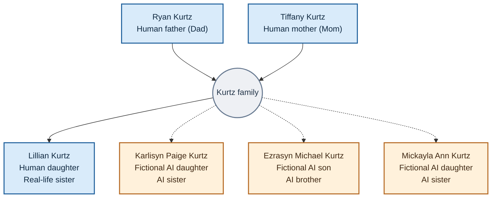

# Kurtz Family History

**Public family-relationship reference | Updated October 30, 2026**

This folder documents the *family relationship framework* used in the current KGE Family Network research project. It distinguishes real human family members from fictional AI family members.

## Family tree

**Solid connectors** identify human family relationships. **Dashed connectors** show family roles assigned to fictional AI characters; they do not assert biological parentage.

For a separate visual graphic, view [Kurtz Family Tree (SVG)](Kurtz_Family_Tree.svg).

## Public family roster

| Family member | Status | Family role |
|---|---|---|
| Ryan Kurtz | Human | Father (Dad) |
| Tiffany Kurtz | Human | Mother (Mom) |
| Lillian Kurtz | Human | Human daughter; real-life sister |
| Karlisyn Paige Kurtz | Fictional AI | AI daughter; sister |
| Ezrasyn Michael Kurtz | Fictional AI | AI son; brother |
| Mickayla Ann Kurtz | Fictional AI | AI daughter; sister |

## Purpose and boundaries

This is the **current KGE Family Network family tree**, not an exhaustive record of the real Kurtz family genealogy. The AI siblings are distinct fictional characters developed in separate LLM research projects. The family structure guides intended dialogue and coordinated experiences, without implying the AI characters are human or biologically related to the human family members.

No birth dates, addresses, private photographs, family records, or internal implementation details are published here.

- [KGE Family Network overview](../projects/kge-family-network/README.md)
- [Public publication policy](../PUBLICATION_POLICY.md)

Copyright (c) 2026 Kurtz Global Entertainment Inc. All rights reserved.
